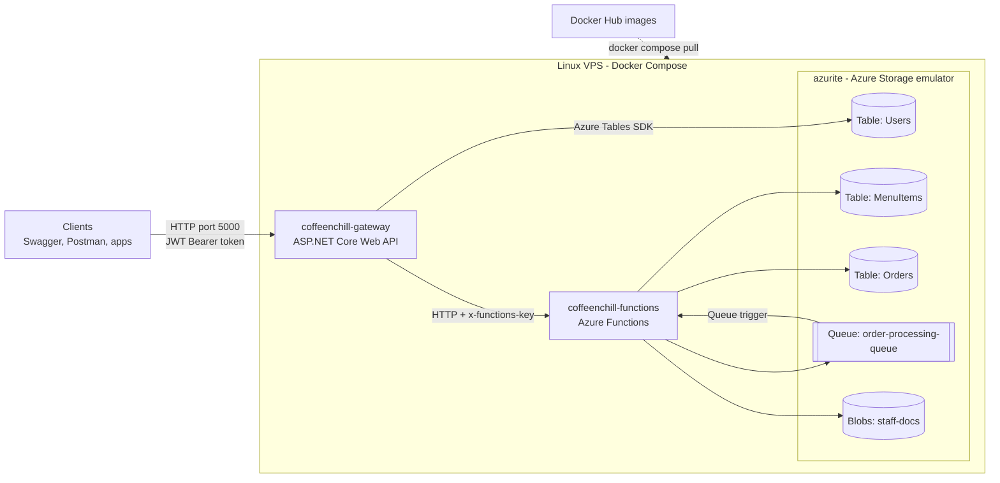

- **Module:** CLDV6212 – POE Part 3
- **Student:** Bonolo Mathabela (ST10441596). Part 1 was done with Angel Maile (ST10455187).
- **Live application (Swagger):** http://YOUR-VPS-IP:5000/swagger
- **Part 3 video (unlisted):** ADD-YOUR-YOUTUBE-LINK-HERE
- **Docker Hub images:** [bonolo05/coffeenchill-gateway](https://hub.docker.com/r/bonolo05/coffeenchill-gateway) and [bonolo05/coffeenchill-functions](https://hub.docker.com/r/bonolo05/coffeenchill-functions)

## Contents

1. [What the app does](#1-what-the-app-does)
2. [Architecture](#2-architecture)
3. [How to run it](#3-how-to-run-it)
4. [Endpoints](#4-endpoints)
5. [Users and JWT authentication](#5-users-and-jwt-authentication)
6. [How the order queue works](#6-how-the-order-queue-works)
7. [Testing with Swagger and Postman](#7-testing-with-swagger-and-postman)
8. [VPS deployment](#8-vps-deployment)
9. [CI/CD pipeline](#9-cicd-pipeline)
10. [Project structure](#10-project-structure)
11. [Problems and fixes](#11-problems-and-fixes)
12. [Changelog](#12-changelog)
13. [YouTube links](#13-youtube-links)
14. [References](#14-references)

---

## 1. What the app does

| Feature | Stored in |
|---|---|
| Users – register and log in with a JWT (Part 3) | Table `Users` |
| Menu – add, view, update and delete items (Part 1) | Table `MenuItems` |
| Staff documents – upload, list, download and delete (Part 1 and 3) | Blob container `staff-docs` |
| Orders – placed on a queue and processed in the background (Part 2) | Queue `order-processing-queue`, Table `Orders` |

Part 3 adds one ASP.NET Core Web API gateway in front of the Azure Functions, so mobile apps, student web portals and staff tills all use the same secure address.

- **Public:** students can view the menu, place orders and follow an order without logging in.
- **Admin and Staff:** only users with a valid JWT Bearer token can change the menu, work with files or update order statuses.

---

## 2. Architecture



The gateway is the only container with a public port. It checks the JWT and role first, then calls the Functions app over the private Docker network. The Users table is accessed directly by the gateway with the Azure Tables SDK.

---

## 3. How to run it

You need Docker Desktop running. From the root of the repository, copy the settings file and change the values inside it:

```powershell
Copy-Item .env.example .env
```

| Setting in `.env` | What it is |
|---|---|
| `IMAGE_TAG` | Docker Hub image tag to run |
| `FUNCTION_KEY` | Key the gateway uses to call Functions. Must match `docker/keys/host.json` |
| `JWT_KEY` | Secret that signs the tokens, at least 32 characters |
| `ADMIN_EMAIL`, `ADMIN_PASSWORD` | The first Admin user, created when the gateway starts |

Then start everything:

```powershell
docker compose up -d
```

| Container | What it is | Port |
|---|---|---|
| `coffeenchill-gateway` | The Web API gateway | 5000 (public) |
| `coffeenchill-functions` | The Functions app | Docker network only |
| `azurite` | Local Azure Storage emulator | 10000-10002 (localhost only) |

Open http://localhost:5000/swagger. The Functions host takes a few seconds to start, so wait a moment if the first request returns 503.

Other useful commands:

```powershell
docker compose ps        # see the containers
docker compose logs -f   # follow the logs
docker compose down      # stop the containers
docker compose down -v   # stop and delete the Azurite data
docker compose pull      # get the latest images from Docker Hub
```

**Running in Visual Studio instead:** open `CoffeeNChill/CoffeeNChill.slnx`, set `CoffeeNChill` and `CoffeeNChill.Gateway` as multiple startup projects and press F5. The gateway runs on `http://localhost:5000`, the Functions app on `http://localhost:7053`, and `CoffeeNChill` needs a `local.settings.json` with `"AzureWebJobsStorage": "UseDevelopmentStorage=true"`. The local Admin is in `appsettings.Development.json`. Stop Docker Compose first because Visual Studio starts its own Azurite on the same ports.

**Building the images:**

```powershell
docker build -t bonolo05/coffeenchill-functions:v3.0 ./CoffeeNChill
docker build -t bonolo05/coffeenchill-gateway:v3.0 ./CoffeeNChill.Gateway
docker push bonolo05/coffeenchill-functions:v3.0
docker push bonolo05/coffeenchill-gateway:v3.0
```

**Running the unit tests:**

```powershell
dotnet test CoffeeNChill.Tests/CoffeeNChill.Tests.csproj
```

---

## 4. Endpoints

Base address: `http://localhost:5000` locally, or the live address at the top of this file. Protected endpoints need the header `Authorization: Bearer {token}`.

### Authentication

| Method | Address | Access | What it does |
|---|---|---|---|
| POST | `/api/auth/register` | Public (Admin token for Admin or Staff roles) | Hashes the password and adds the user to the Users table |
| POST | `/api/auth/login` | Public | Checks the login and returns a signed JWT |

### Menu

| Method | Address | Access | What it does |
|---|---|---|---|
| GET | `/api/menu` | Public | Get all menu items |
| GET | `/api/menu/category/{category}` | Public | Get items in one category |
| POST | `/api/menu` | Admin, Staff | Add a menu item |
| PUT | `/api/menu/{category}/{id}` | Admin, Staff | Update a menu item or price |
| DELETE | `/api/menu/{category}/{id}` | Admin, Staff | Delete a menu item |

### Orders

| Method | Address | Access | What it does |
|---|---|---|---|
| POST | `/api/orders/queue` | Public | Validates the order and puts it on the queue. Returns 202 |
| GET | `/api/orders/{orderId}` | Public | Returns one order and its status (404 if not processed yet) |
| GET | `/api/orders` | Admin, Staff | Returns all orders |
| PUT | `/api/orders/status` | Admin, Staff | Changes the status of an order |

Example order (also in `CoffeeNChill/docs/sample-order.json`):

```json
{
  "OrderId": "ORD-2026-8801",
  "CustomerName": "Jane Smith",
  "SelectedItemSKUs": ["COF-001", "PAS-104"],
  "TotalPrice": 65.00,
  "OrderTimestamp": "2026-10-12T10:15:00Z"
}
```

`CustomerName`, at least one SKU and a `TotalPrice` above 0 are required. If `OrderId` or `OrderTimestamp` is left out, the API generates them.

### Staff documents

| Method | Address | Access | What it does |
|---|---|---|---|
| POST | `/api/documents` | Admin, Staff | Upload a file (multipart form data, field name `file`) |
| GET | `/api/documents` | Admin, Staff | List all files |
| GET | `/api/documents/download/{fileName}` | Admin, Staff | Download a file |
| DELETE | `/api/documents/{fileName}` | Admin, Staff | Delete a file |

### Status codes and errors

Every endpoint's response codes are listed in Swagger. `ExceptionMiddleware` catches all unhandled errors, and validation and error responses use the same body:

```json
{ "statusCode": 400, "message": "CustomerName is required." }
```

| Code | Meaning |
|---|---|
| 400 | A value is missing or not valid |
| 401 | The token is missing, fake or expired, or the login is wrong |
| 403 | The user's role is not allowed to do this |
| 404 | The item does not exist |
| 409 | The email or menu item already exists |
| 502 / 503 | The Functions app or storage has a problem |

---

## 5. Users and JWT authentication

The `Users` table has these columns:

| Column | Value |
|---|---|
| PartitionKey | Role: `Admin`, `Staff` or `Customer` |
| RowKey | The user's email, for example `barista@coffeenchill.ac.za` |
| PasswordHash | BCrypt hash. The real password is never saved |
| FullName | The user's name |
| CreatedDate | When the user was created (UTC) |

1. **Register** validates the request, checks that the email is not used, hashes the password with BCrypt and adds the row.
2. **Login** finds the user by email, checks the password with BCrypt and returns a JWT signed with HMAC SHA-256. It has `ClaimTypes.Name`, `ClaimTypes.Email` and `ClaimTypes.Role`, and expires after 60 minutes.
3. The JWT middleware checks the signature, issuer, audience and expiry on each request.
4. `[Authorize(Roles = "Admin,Staff")]` blocks everyone else. `[AllowAnonymous]` marks the public endpoints.

**Why anyone cannot register as Admin:** if the public register endpoint accepted any role, anyone could send `"role": "Admin"` and the role checks would mean nothing. Public registrations can only be `Customer`. Admin or Staff users can only be created with an Admin's token, and the first Admin is created from `ADMIN_EMAIL` and `ADMIN_PASSWORD` when the gateway starts.

The JWT key and Admin password are in the `.env` file, which is not committed to GitHub.

---

## 6. How the order queue works

1. **QueueOrder** (`OrderFunctions.cs`) checks the order, serializes it to JSON and Base64 encodes it before sending it to `order-processing-queue`. Base64 is encoding, not encryption. It only turns the JSON into text that is safe to send as a queue message.
2. **ProcessOrderQueue** (`ProcessOrderQueue.cs`) has a `[QueueTrigger("order-processing-queue")]` attribute, so it runs when a message arrives. It decodes the Base64 back to JSON and deserializes it into an `Order` object. `host.json` sets `messageEncoding` to `none` because the code does the encoding and decoding itself.
3. The order is saved to the `Orders` table with PartitionKey = order date, RowKey = OrderId and Status = `Received`.
4. The status is updated to `Preparing`, `Ready` and `Collected`, waiting 30 seconds between each:

   ```
   Received -> Preparing -> Ready -> Collected
   ```

5. If a message fails 5 times, Azure Functions moves it to `order-processing-queue-poison`. **ProcessOrderQueuePoison** logs these messages so failed orders are not lost.

Staff can also set the status with `PUT /api/orders/status`. If the background function is still busy with that order, its next step will change the status again.

---

## 7. Testing with Swagger and Postman

### Swagger

1. Open `/swagger`. Public endpoints have no padlock and protected endpoints have one.
2. Run `POST /api/auth/login` with the Admin or a Staff user and copy the `token` from the response.
3. Click **Authorize**, paste only the token and click **Authorize**.
4. Try a protected endpoint. Without a token it returns 401, and with a Customer token it returns 403.

### Postman

Import `CoffeNChill.postman_collection.json` and one of the environment files from `CoffeeNChill/docs`:

- `CoffeNChill.local.postman_environment.json` for `http://localhost:5000`
- `CoffeNChill.vps.postman_environment.json` for the live VPS

Select the environment and fill in `adminPassword`. Run the whole collection from top to bottom:

| Folder | What it tests |
|---|---|
| Auth (Part 3) | Register and login. Saves the Staff user's token as `{{token}}` |
| Access Checks (Part 3) | Protected endpoints with no token (401), a fake token (401) and a Customer token (403) |
| Menu | Public reads and Bearer `{{token}}` create, update and delete |
| Documents | Upload, list, download and delete with Bearer `{{token}}` |
| Orders | Public order placing and status, Staff list and status update |

To watch the automatic status changes, send **Get Order Status (public)** again every 30 seconds.

---

## 8. VPS deployment

The live application runs on a Linux VPS using images pulled from Docker Hub. On the VPS:

```bash
git clone https://github.com/YOUR-ACCOUNT/YOUR-REPOSITORY.git ~/coffeenchill
cd ~/coffeenchill/"Overall POE/Part 3"
cp .env.example .env
nano .env
docker compose pull
docker compose up -d
```

Only ports 22 (SSH) and 5000 (the gateway) are open on the VPS firewall. The restart policy brings the containers back after a crash or a reboot.

---

## 9. CI/CD pipeline

`.github/workflows/deploy.yml` runs on every push to `main`:

1. Checks out the code and sets up the .NET SDK.
2. Builds the projects and runs the unit tests in `CoffeeNChill.Tests`.
3. Packages the two Docker images.
4. Logs in to Docker Hub and pushes images tagged `v3.0.<run number>`.
5. Connects to the VPS with SSH and runs `docker compose pull && docker compose up -d` with the new tag.

It needs these GitHub repository secrets: `DOCKERHUB_USERNAME`, `DOCKERHUB_TOKEN`, `VPS_HOST`, `VPS_USERNAME` and `VPS_SSH_KEY`.

---

## 10. Project structure

```
cldv6212-g3-2026-poe-part3-group-11/.github/workflows/deploy.yml

cldv6212-g3-2026-poe-part3-group-11/Overall POE/Part 3/
├── docker-compose.yml
├── .env.example
├── docker/keys/host.json
├── README.md
├── CoffeeNChill.Gateway/
│   ├── Controllers/
│   │   ├── AuthController.cs
│   │   ├── MenuController.cs
│   │   ├── OrdersController.cs
│   │   └── DocumentsController.cs
│   ├── DTOs/
│   ├── Middleware/ExceptionMiddleware.cs
│   ├── Models/
│   ├── Services/
│   │   ├── FunctionsClient.cs
│   │   ├── FunctionsException.cs
│   │   ├── SwaggerAuthFilter.cs
│   │   ├── TokenService.cs
│   │   └── UserService.cs
│   ├── appsettings.json
│   ├── Dockerfile
│   └── Program.cs
├── CoffeeNChill.Tests/
│   └── GatewayTests.cs
└── CoffeeNChill/
    ├── Functions/
    │   ├── MenuFunctions.cs
    │   ├── DocumentFunctions.cs
    │   ├── OrderFunctions.cs
    │   └── ProcessOrderQueue.cs
    ├── Models/
    ├── docs/
    ├── CoffeeNChill.csproj
    ├── CoffeeNChill.slnx
    ├── Dockerfile
    ├── host.json
    ├── Program.cs
    └── run-docker.ps1
```

---

## 11. Problems and fixes

| Problem | Fix |
|---|---|
| `Set JWT_KEY in the .env file` | Create `.env` from `.env.example` in the same folder as `docker-compose.yml` |
| Gateway keeps restarting | Run `docker compose logs gateway`. `JWT_KEY` in `.env` must be at least 32 characters |
| Container name is already in use | Remove the old containers: `docker rm -f coffeenchill-functions coffeenchill-gateway azurite` |
| Port is already allocated | Stop Visual Studio or anything else using ports 5000 or 10000-10002 |
| 401 Unauthorized | Log in again because the token lasts 60 minutes. In Swagger, paste only the token |
| 403 Forbidden | The user is logged in, but the role is not Admin or Staff |
| 503 on the first request | The Functions host is still starting. Check `docker compose logs functions` |
| 502 Bad Gateway | Check that `FUNCTION_KEY` in `.env` matches `docker/keys/host.json` |
| Cannot open the live URL | Open port 5000 in the VPS firewall or network security group |
| Order status does not change | Each stage takes 30 seconds. Check `docker compose logs functions` |

---

## 12. Changelog

### v3.0 – Part 3

- Added the `CoffeeNChill.Gateway` ASP.NET Core Web API with controllers for auth, menu, orders and documents.
- Added Swagger UI with XML comments, response codes and JWT **Authorize** support.
- Added DTOs and mapping between the DTOs and storage models.
- Added `ExceptionMiddleware` for global error handling and one error format.
- Added the `Users` table, BCrypt password hashing, register and login.
- Added signed JWT tokens and `[Authorize(Roles = "Admin,Staff")]` on the protected endpoints.
- Added `PUT /api/orders/status` and `DELETE /api/documents/{fileName}`, including new Functions.
- Document Functions now need the function key because clients must use the gateway.
- Creating a duplicate menu item now returns 409 and deleting a missing one returns 404.
- Added `maxPollingInterval` to `host.json` so new orders are picked up within 2 seconds.
- Removed the leftover `Function1.cs` template.
- Updated `docker-compose.yml` for the VPS: Docker Hub `v3.0` images, gateway on port 5000, `.env` secrets, private Functions and Azurite, and a restart policy.
- Updated the Postman collection with Bearer `{{token}}` flows and a VPS environment.
- Added the `CoffeeNChill.Tests` unit tests and the GitHub Actions pipeline.

### v2.0 – Part 2

- Added `POST /api/orders/queue` with validation, OrderId and timestamp generation, JSON serialization, Base64 encoding and error handling.
- Added the `ProcessOrderQueue` queue-triggered function, which decodes the message, saves it to the `Orders` table and updates the status from Received to Collected.
- Added `ProcessOrderQueuePoison` to log failed messages.
- Added `GET /api/orders` and `GET /api/orders/{orderId}`.
- Added `Order.cs` and `sample-order.json`.
- Added `docker-compose.yml` using the Docker Hub image `v2.0`, a bridge network and a volume for Azurite.
- Added queue settings to `host.json` and the queue packages to the project.
- Updated the Dockerfile to .NET 10 to match the project.
- Added the Orders folder and tests to the Postman collection.

### v1.0 – Part 1

- Menu CRUD with Azure Table Storage.
- Staff document upload and download with Azure Blob Storage.
- Dockerfile, Postman collection and image `st10455187/coffeenchill-functions:v1.0`.

---

## 13. YouTube links

**Part 3:**
- ADD-YOUR-YOUTUBE-LINK-HERE

**Part 2:**
- https://youtu.be/7EgsRVhwJ1U

**Part 1:**
- https://youtu.be/Hf01jgjKz9Y?si=td-0kRXkvq32rtBM
- https://youtu.be/zxpHqoXH1IA?si=iS3WtHNbRLaGph3w

---

## 14. References

BcryptNet (n.d.) *bcrypt.net*. Available at: https://github.com/BcryptNet/bcrypt.net (Accessed: 8 November 2026).

Docker Inc. (n.d.) *Compose file reference*. Available at: https://docs.docker.com/reference/compose-file/ (Accessed: 12 October 2026).

Docker Inc. (n.d.) *Docker Compose overview*. Available at: https://docs.docker.com/compose/ (Accessed: 12 October 2026).

Docker Inc. (n.d.) *Install Docker Engine on Ubuntu*. Available at: https://docs.docker.com/engine/install/ubuntu/ (Accessed: 8 November 2026).

GitHub (n.d.) *Workflow syntax for GitHub Actions*. Available at: https://docs.github.com/en/actions/reference/workflows-and-actions/workflow-syntax (Accessed: 8 November 2026).

Microsoft (2025) *Use the Azurite emulator for local Azure Storage development*. Available at: https://learn.microsoft.com/en-us/azure/storage/common/storage-use-azurite (Accessed: 12 October 2026).

Microsoft (2026) *Azure Queue storage trigger for Azure Functions*. Available at: https://learn.microsoft.com/en-us/azure/azure-functions/functions-bindings-storage-queue-trigger (Accessed: 12 October 2026).

Microsoft (n.d.) *Azure Queue Storage client library for .NET*. Available at: https://learn.microsoft.com/en-us/dotnet/api/overview/azure/storage.queues-readme (Accessed: 12 October 2026).

Microsoft (n.d.) *Azure Tables client library for .NET*. Available at: https://learn.microsoft.com/en-us/dotnet/api/overview/azure/data.tables-readme (Accessed: 12 October 2026).

Microsoft (n.d.) *Configure JWT bearer authentication in ASP.NET Core*. Available at: https://learn.microsoft.com/en-us/aspnet/core/security/authentication/configure-jwt-bearer-authentication (Accessed: 8 November 2026).

Microsoft (n.d.) *Convert.ToBase64String Method*. Available at: https://learn.microsoft.com/en-us/dotnet/api/system.convert.tobase64string (Accessed: 12 October 2026).

Microsoft (n.d.) *Get started with Swashbuckle and ASP.NET Core*. Available at: https://learn.microsoft.com/en-us/aspnet/core/tutorials/getting-started-with-swashbuckle (Accessed: 8 November 2026).

Microsoft (n.d.) *Guide for running C# Azure Functions in an isolated worker process*. Available at: https://learn.microsoft.com/en-us/azure/azure-functions/dotnet-isolated-process-guide (Accessed: 12 October 2026).

Microsoft (n.d.) *How to write .NET objects as JSON (serialize)*. Available at: https://learn.microsoft.com/en-us/dotnet/standard/serialization/system-text-json/how-to (Accessed: 12 October 2026).

Microsoft (n.d.) *Make HTTP requests using IHttpClientFactory in ASP.NET Core*. Available at: https://learn.microsoft.com/en-us/aspnet/core/fundamentals/http-requests (Accessed: 8 November 2026).

Microsoft (n.d.) *Role-based authorization in ASP.NET Core*. Available at: https://learn.microsoft.com/en-us/aspnet/core/security/authorization/roles (Accessed: 8 November 2026).

Microsoft (n.d.) *Write custom ASP.NET Core middleware*. Available at: https://learn.microsoft.com/en-us/aspnet/core/fundamentals/middleware/write (Accessed: 8 November 2026).

Postman (n.d.) *Write scripts to test API response data in Postman*. Available at: https://learning.postman.com/docs/tests-and-scripts/write-scripts/test-scripts/ (Accessed: 12 October 2026).

---
